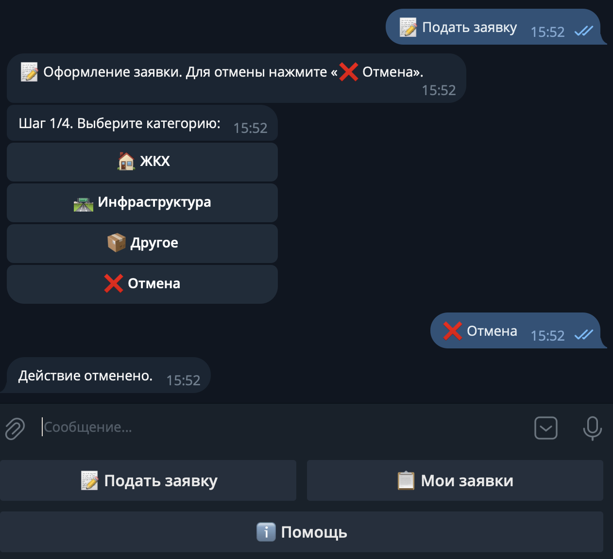
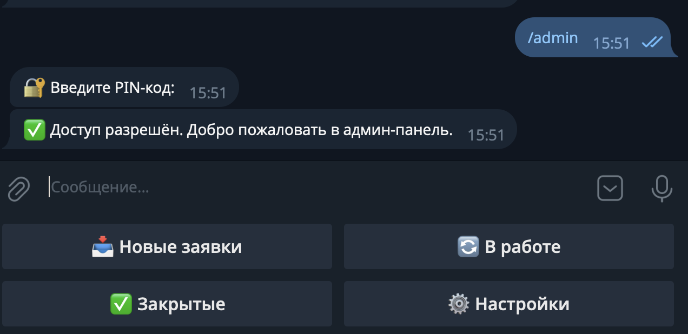
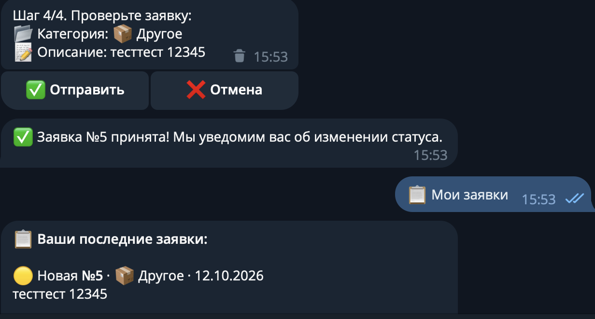

# 🎫 Тикет-система жалоб — Telegram-бот

Бот для приёма и обработки заявок и жалоб. Клиенты оформляют заявки прямо в Telegram, администраторы берут их в работу, закрывают с фотоотчётом или отклоняют, а клиент получает уведомление о каждом изменении статуса.

> Только текст, inline-кнопки и reply-клавиатуры: без WebApp, Docker, внешних БД и фоновых планировщиков. Запускается одной командой.

## ✨ Возможности

**Для клиента**
- Подача заявки по шагам: категория → описание (10–800 символов) → фото (необязательно) → подтверждение
- Список последних заявок со статусами и ответом администратора
- Уведомления: заявка взята в работу, выполнена (с фотоотчётом), отклонена (с причиной)

**Для администратора**
- Вход по PIN-коду, сообщение с PIN сразу удаляется из чата
- Просмотр новых заявок с навигацией «Следующая»
- Взять в работу, отклонить с причиной, закрыть с комментарием и фотоотчётом
- Разделы «В работе» и «Закрытые», статистика по статусам в настройках

**Статусы заявки:** 🟡 Новая → 🔵 В работе → 🟢 Выполнена / 🔴 Отклонена

## 🧱 Стек

| Компонент | Технология |
|---|---|
| Язык | Python 3.10+ |
| Фреймворк бота | aiogram 3.x (Router, MagicFilter, CallbackData, FSM) |
| ORM | SQLAlchemy 2.0 async (`DeclarativeBase`, `Mapped`) |
| БД | SQLite через aiosqlite |
| Конфиг | python-dotenv |

## 🧠 Технические решения

- **Защита от гонки администраторов.** `take_ticket`, `close_ticket` и `reject_ticket` выполняют условный `UPDATE ... WHERE status = ...` и проверяют `rowcount`: если два админа нажали одновременно, заявку получит только один.
- **FSM без «залипания».** Кнопки меню сбрасывают состояние, а `/cancel` и «❌ Отмена» работают в любом состоянии. Для каждого шага, ожидающего текст или фото, есть обработчик неверного типа сообщения.
- **Безопасные уведомления.** Отправка клиентам идёт через `safe_send`: если пользователь заблокировал бота, ошибка логируется, а бот продолжает работу.
- **PIN в виде хэша.** В репозитории и `.env` хранится только SHA-256, сравнение выполняется через `hmac.compare_digest`.
- **Карточки без `edit_text`.** Сообщения с фото нельзя редактировать как текст, поэтому старая карточка удаляется, а новая отправляется заново.
- **Глобальный обработчик ошибок** логирует исключение и сообщает пользователю, не роняя бота.
- **Роли в БД.** Фильтр `IsAdmin` проверяет роль пользователя по базе при каждом обращении к админ-панели.

## 🗂 Структура проекта

```
bot/
├── main.py              # точка входа: логирование, init_db, роутеры, polling
├── config.py            # загрузка .env, проверка PIN
├── hash_password.py     # генерация хэша PIN
├── database/            # engine, модели User/Ticket, CRUD-функции
├── handlers/            # common, client, admin (auth_router + router)
├── keyboards/           # inline и reply клавиатуры, CallbackData
├── states/              # состояния FSM
├── filters/             # IsAdmin
└── utils/               # форматирование карточек, safe_send/safe_delete
```

## 🚀 Запуск

1. Клонируйте репозиторий и установите зависимости (нужен Python 3.10+):
   ```bash
   cd bot
   python3 -m venv venv
   source venv/bin/activate
   pip install -r requirements.txt
   ```
2. Создайте `.env` и вставьте токен от [@BotFather](https://t.me/BotFather):
   ```bash
   cp .env.example .env
   ```
   Демо-PIN администратора: `1234`. Чтобы задать свой, запустите `python hash_password.py` и вставьте полученный хэш в `.env`.
3. Запустите бота:
   ```bash
   python main.py
   ```
   Откройте бота в Telegram и нажмите `/start`. Для входа в админку напишите «Режим админа».

## 📸 Демо

| Подача заявки | Панель администратора | Уведомление клиенту |
|---|---|---|
|  |  |  |

## 📄 Лицензия

MIT
